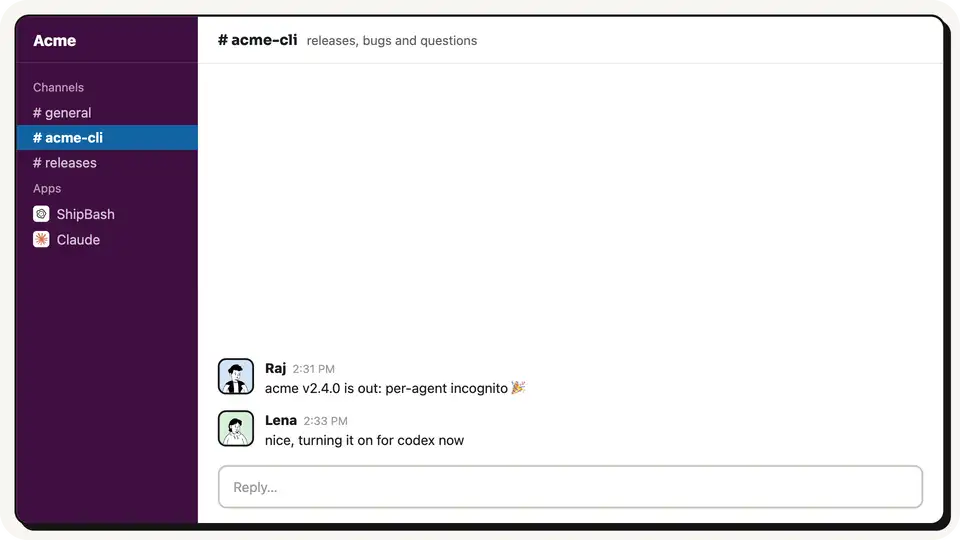
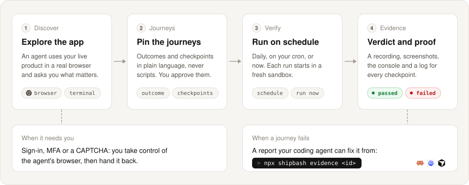
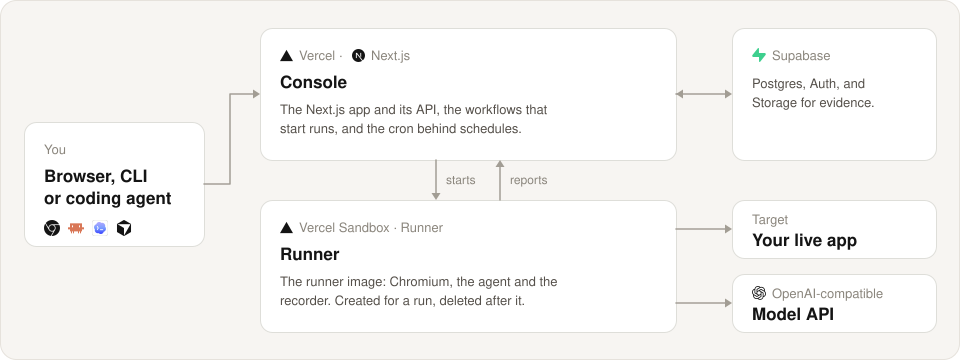

<p align="center">
  
  
</p>

<p align="center"><strong>You ship it. We bash it.</strong></p>

<p align="center">Your agent says it's done. ShipBash shows you it works. It tests your web app and your CLI like a real user, on production, with a recording of every verdict.</p>

<p align="center">
  <a href="LICENSE"></a>
  <a href="https://www.npmjs.com/package/shipbash"></a>
</p>

<p align="center">
  <a href="https://shipbash.dev">Website</a> ·
  <a href="https://app.shipbash.dev">Console</a> ·
  <a href="packages/cli">CLI</a> ·
  <a href="#self-host">Self-host</a>
</p>

<p align="center"><strong>English</strong> · <a href="README.zh-CN.md">简体中文</a></p>

<p align="center">
  <a href="https://shipbash.dev/shipbash-demo.mp4"></a>
</p>

## What it does

Open-source AI QA that uses your web app and your CLI like a real user, on
production. Every verdict comes with a captioned recording, and every failure
with a report your coding agent can fix from.

Give it your product's URL and it explores the product with you, in a real
browser and terminal, until the journeys that matter are pinned down: signing
up, checking out, installing your CLI. Each journey is an outcome with
checkpoints in plain language, not a script or a list of selectors.

ShipBash then runs them on a schedule, or when you ask. In Slack, mention
@ShipBash in a thread and it checks what you just shipped. You can check any
verdict without redoing the test: the recording, screenshots, console output
and a log for each checkpoint.

## How it works

<picture>
  <source media="(prefers-color-scheme: dark)" srcset=".github/assets/how-it-works-dark.svg">
  
</picture>

ShipBash is the harness around a general-purpose agent: the browser and
terminal it drives, its memory, and the record of its past runs. It writes no
test scripts; the agent works out each step from the journey's outcome and
checkpoints. Every run starts in a fresh sandbox that is deleted when the run
ends. When the product needs a person, you act in the agent's browser and hand
it back; ShipBash encrypts the signed-in session and reuses it in later runs.

## Get started

The hosted version at [app.shipbash.dev](https://app.shipbash.dev) is
invite-only for now: signing in puts you on the waitlist, and once you are let
in you add your product's URL and start a discovery.

Or paste this line into Claude Code, Codex or Cursor and let the agent set it
up with the [`shipbash` CLI](packages/cli):

```text
Read shipbash.dev/setup.md and set up ShipBash for this project.
```

The CLI works the same from your own terminal:

```bash
npx shipbash login
npx shipbash projects add https://app.acme.example
npx shipbash journeys add --project <project>
```

## Self-host

A deployment is a Vercel project for the console and its runs, and a Supabase
database.

<picture>
  <source media="(prefers-color-scheme: dark)" srcset=".github/assets/self-host-dark.svg">
  
</picture>

<p/>
<p align="center">
  <a href="https://vercel.com/new/clone?repository-url=https%3A%2F%2Fgithub.com%2Fdohooo%2Fshipbash&project-name=shipbash&repository-name=shipbash&stores=%5B%7B%22type%22%3A%22integration%22%2C%22integrationSlug%22%3A%22supabase%22%2C%22productSlug%22%3A%22supabase%22%7D%5D&env=OPENAI_BASE_URL,OPENAI_API_KEY,TYPESAFE_API_URL,TYPESAFE_API_KEY&envDescription=The%20endpoints%20and%20keys%20of%20the%20models%20your%20agents%20call%3A%20an%20OpenAI-compatible%20model%20and%20TypeSafe.%20The%20other%20variables%20are%20in%20.env.example.&envLink=https%3A%2F%2Fgithub.com%2Fdohooo%2Fshipbash%2Fblob%2Fmain%2F.env.example">
    <picture>
      <source media="(prefers-color-scheme: dark)" srcset=".github/assets/deploy-button-dark.svg">
      
    </picture>
  </a>
</p>

The button clones this repository, creates the Vercel project, attaches a
Supabase database through Vercel's Supabase integration, and asks for the
endpoints and keys of the models your agents call. Then:

1. Add the other variables in `.env.example`, including its hosted-only
   section, to the project's environment variables. The integration has
   already set the database ones.
2. From a clone of the new repository, apply the migrations with the
   project's `POSTGRES_URL_NON_POOLING`:
   `bunx supabase db push --db-url "$POSTGRES_URL_NON_POOLING"`.
3. Build the runner image from `packages/runner/Dockerfile`, push it to the
   project's Vercel container registry, and set `SHIPBASH_RUNNER_IMAGE` to the
   pushed image.

Point the CLI at your deployment with
`npx shipbash login --origin https://<your-console>`.

## Develop locally

You need Node.js 22 or later, the Bun version that package.json's
`packageManager` names, and Docker.

```bash
git clone https://github.com/dohooo/shipbash.git
cd shipbash
bun install
```

Copy `.env.example` to `.env` and `.env.local.example` to `.env.local`, fill
them in, then:

```bash
bun run dev:doctor   # check the setup without starting anything
bun run dev          # local Supabase, the runner image, the console and the runner service
```

Open the console at <http://127.0.0.1:4173>; sign-in does not work on
`localhost`. Runs use the same runner image on your local Docker instead of
Vercel Sandbox. The checks:

```bash
bun run typecheck
bun run lint
bun run build
```

Before a pull request, read [CONTRIBUTING.md](CONTRIBUTING.md); report vulnerabilities as [SECURITY.md](SECURITY.md) describes.

## License

[Apache License 2.0](LICENSE). Third-party notices are in [NOTICE](NOTICE).
